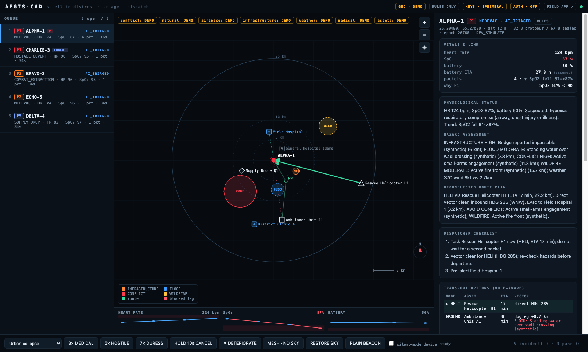
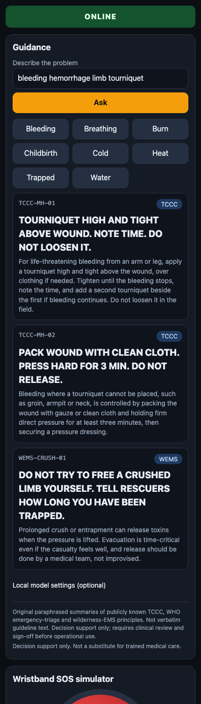
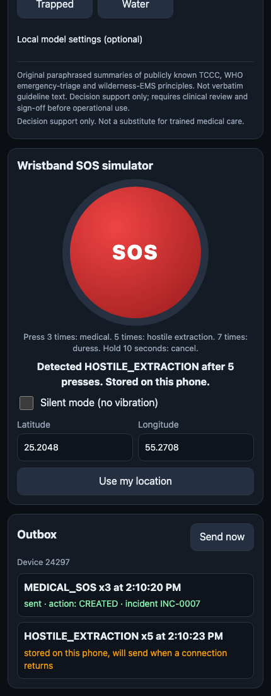
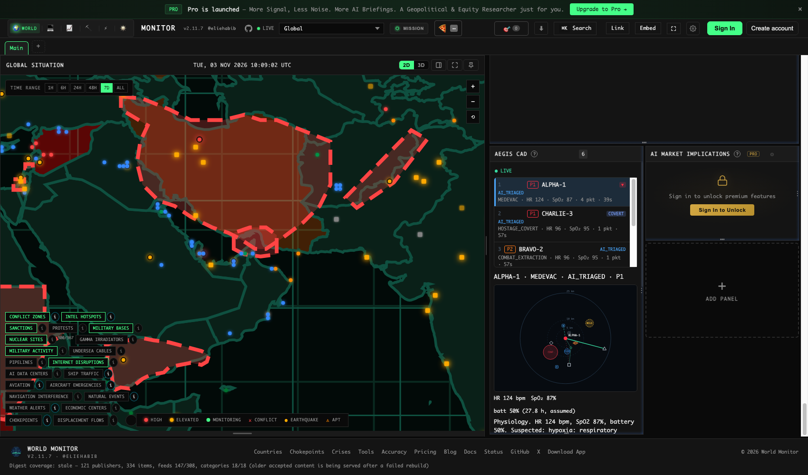
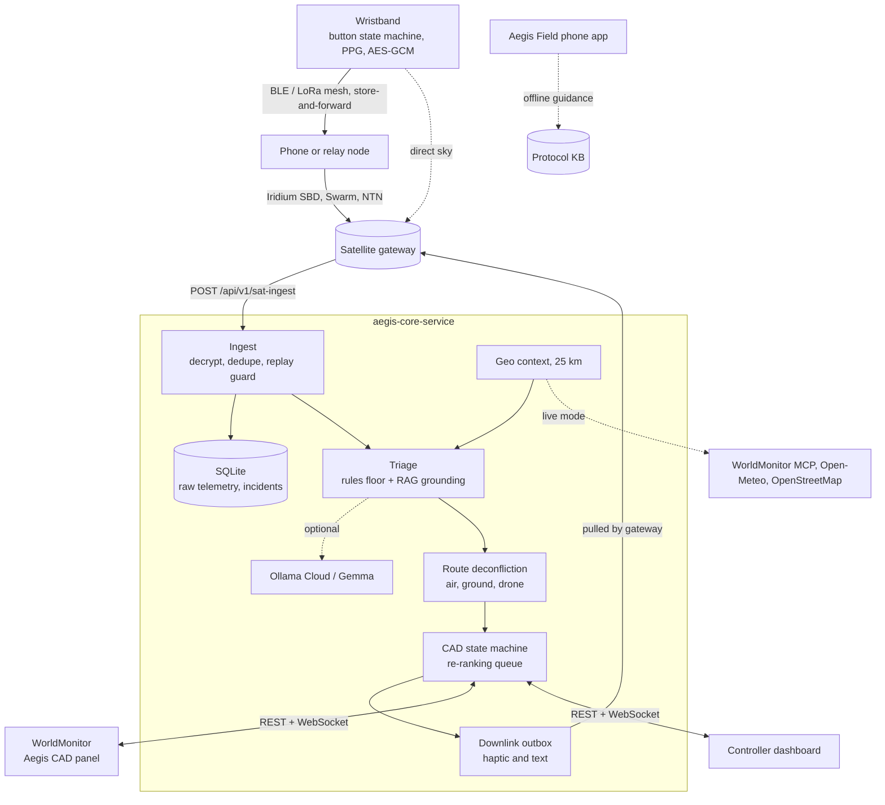

# AegisMonitor

**Satellite distress beacons in, triaged dispatch incidents out.** An active rescue, medical-triage and extraction
platform built on [WorldMonitor](https://github.com/koala73/worldmonitor) (vendored in [`worldmonitor/`](worldmonitor/)).



> **Everything here is synthetic by default.** No live satellite provider, no patient data, no real conflict data.
> Demo mode labels every hazard, facility and asset `DEMO_SCENARIO`, and the UI says so (the `DEMO` chips in the screenshots).

## Contents

- [What it is](#what-it-is)
- [Screenshots](#screenshots)
- [Architecture](#architecture)
- [Quick start](#quick-start)
- [How a beacon becomes a dispatch decision](#how-a-beacon-becomes-a-dispatch-decision)
- [Status against the brief](#status-against-the-brief)
- [Brief vs WorldMonitor](#brief-vs-worldmonitor-what-the-real-source-showed)
- [Output contract](#output-contract-brief-3)
- [API](#api)
- [Configuration](#configuration)
- [Tests](#tests)
- [Assumptions and open questions](#assumptions-and-open-questions)
- [Security notes](#security-notes) · [Dual-use flag](#dual-use-flag)
- [Repository layout](#repository-layout) · [Licensing](#licensing)

## What it is

| Piece | Where | What it does |
|---|---|---|
| **aegis-core-service** | [`src/`](src/) | Encrypted binary ingest, wristband gesture pipeline, store-and-forward mesh, 25 km geo-context, RAG-grounded triage to the brief §3 schema, mode-aware route deconfliction, biometric re-ranking, CAD state machine, downlink outbox, SQLite incident database |
| **Controller dashboard** | [`public/index.html`](public/index.html) | Standalone dispatcher workspace: re-ranking queue, tactical map, vitals, one-click downlink |
| **Aegis CAD panel for WorldMonitor** | [`worldmonitor/src/components/AegisCadPanel.ts`](worldmonitor/src/components/AegisCadPanel.ts) | The same workspace inside the real WorldMonitor dashboard, talking to the core service over REST + WebSocket only |
| **Aegis Field** (user app) | [`public/field.html`](public/field.html) | Offline-first phone companion: protocol guidance with an optional local Gemma, an SOS simulator and a store-and-forward outbox |

## Screenshots

### Controller dashboard

The dispatcher's view. ALPHA-1 climbed to **rank 1 / P1** after four packets with falling SpO₂ (see the ▼ flag and the
sparkline), CHARLIE-3 is **COVERT** (duress: only a haptic acknowledgement may be sent), and the map shows the 25 km
rings, mode-colored hazards, assets, the recommended helicopter vector and the ambulance's **dogleg** around a flooded crossing.


### User dashboard (Aegis Field, phone)

Offline-first guidance retrieved from the protocol knowledge base (here: bleeding, tourniquet first), then the wristband
SOS simulator and outbox. The medical SOS was **sent** and created an incident; after the connection was cut, the
hostile-extraction gesture is **stored on the phone** and flushes when the network returns.

<table>
  <tr>
    <td align="center"><b>Guidance</b></td>
    <td align="center"><b>SOS simulator and outbox</b></td>
  </tr>
  <tr>
    <td></td>
    <td></td>
  </tr>
</table>

### World view (WorldMonitor with the Aegis CAD panel)

The real WorldMonitor dashboard with the **Aegis CAD** panel enabled (bottom right: `LIVE`, the incident queue, and the
selected incident's tactical map). Clicking an incident recenters WorldMonitor's main map on it.



> The screenshots were captured from headless Chrome against the demo scenario, so the main WorldMonitor map shows no
> basemap tiles. The panel, the queue and the tactical map are the real rendering.

## Architecture



**AGPL decoupling.** WorldMonitor is AGPL-3.0. The core service imports nothing from `worldmonitor/`; the only seam is
the documented REST + WebSocket API ([`contracts/openapi.yaml`](contracts/openapi.yaml)).

## Quick start

Requires **Node >= 22.13** (the incident database uses `node:sqlite`). The core service has **zero npm dependencies**.

```bash
npm start      # http://127.0.0.1:3001   controller dashboard at /, phone app at /field.html, WebSocket at /ws
npm test       # 152 tests in about a second
```

In the dashboard footer: **3× MEDICAL**, **5× HOSTILE**, **7× DURESS**, **HOLD 10s CANCEL**, **▼ DETERIORATE** (feed falling
vitals to the selected device and watch it re-rank), **MESH · NO SKY** then **RESTORE SKY** (store-and-forward).

> Port 3001 is a common dev port. If `localhost:3001` shows a different app, use `127.0.0.1:3001` (the service binds
> IPv4 loopback) or set `PORT`.

### Inside WorldMonitor

```bash
cd worldmonitor
npm ci --ignore-scripts
npm run inventory:facts        # writes gitignored files a fresh upstream checkout needs
VITE_VARIANT=full npx vite --port 5173 --host 127.0.0.1
```

Then enable **Aegis CAD (Rescue Dispatch)** in panel settings (or press `⌘K` and search "aegis"), with the core service
running on `127.0.0.1:3001` (override with `VITE_AEGIS_URL`). See [`worldmonitor/VENDORED.md`](worldmonitor/VENDORED.md)
for the exact list of files added and modified upstream.

## How a beacon becomes a dispatch decision

1. **Seal.** The wristband packs a protobuf (or CBOR) beacon (about 30 B) and seals it with AES-256-GCM under a per-device,
   per-epoch key. The sealed envelope is 65-73 B, under the 100 B cap.
2. **Hop.** With no line of sight the sealed packet is relayed by BLE/LoRa through up to 3 nodes, or **stored** until a node
   gains sky. The ciphertext is never re-encrypted.
3. **Ingest.** `/api/v1/sat-ingest` authenticates by the GCM tag, drops duplicates (several mesh paths), enforces a per-device
   monotonic timestamp, stores the raw telemetry, and either opens an incident or **updates the device's open one**.
4. **Triage.** Deterministic rules set priority and category (duress or SpO₂ < 90 or HR > 130 or < 45 → P1; falling vitals
   escalate one level). Retrieval over the protocol KB grounds the first-aid reply; the optional model pass can only refine.
5. **Deconflict.** For each available asset and mode the engine tests the straight leg against the hazards that block *that
   mode*, weather limits included, and searches for a safe dogleg if the direct vector is blocked.
6. **Dispatch.** The incident enters the re-ranking queue. A dispatcher assigns a unit; the device gets a `DISPATCHED` haptic
   through the downlink outbox. Duress or silent-mode incidents can only ever receive `HAPTIC_ACK_ONLY`.

## Status against the brief

Status words are literal: **IMPLEMENTED** = exercised by an automated test and/or driven in a real browser;
**STUB** = logic is real and tested, the hardware or provider edge is simulated; **NOT BUILT** = absent.

| Brief | Status | Where / evidence |
|---|---|---|
| §2A.1 Binary protocol < 100 B, Protobuf **or** CBOR | IMPLEMENTED | `src/proto.mjs`; both codecs round-trip; sealed beacon 65-73 B; 3-bit SOS enum incl. CANCEL |
| §2A.2 Store-and-forward mesh, hop limit | IMPLEMENTED (simulation) | `src/mesh.mjs`: packets stored with no sky, delivered when sky returns, dedupe, 3 hops. **No BLE/LoRa driver.** |
| §2A.3 3 / 5 presses, hold 10 s | IMPLEMENTED | `ButtonMachine` timed state machine (also 7 = duress, see assumptions) |
| §2A.3 Three haptic patterns | IMPLEMENTED | server queues ACK on every packet and DISPATCHED on assignment; device pulls via `/devices/{id}/downlink/pull` |
| §2A.3 PPG HR + SpO2 into the payload | **STUB sensor / real algorithm** | `analysePPG` recovers HR/SpO2 from raw red/IR within 2 on synthetic waveforms; `pollPPG` is the stubbed sensor read |
| §2A.4 AES-256-GCM, pre-shared rotating keys | IMPLEMENTED | per-device HKDF keys, daily epochs, header bound as AAD. Master is ephemeral unless `AEGIS_MASTER_KEY` is set |
| §2A.4 Silent Beacon mode | IMPLEMENTED (policy) | `silent_mode` device flag → haptic-only. Random 90-260 s jitter. **No RF code**, see dual-use note |
| §2A.4 Duress flags HOSTAGE/CAPTURED, wipes log | IMPLEMENTED (policy) | 7-press gesture; log wipe is a policy flag, there is no device log here |
| §2A.5 On-device Gemma 2B/4B | **PARTIAL** | `field.html` calls a local Ollama (`contracts/Modelfile.edge`). **No bundled native model, no MediaPipe, no mobile app build.** |
| §2B.1 `/api/v1/sat-ingest`: decrypt, validate, store raw telemetry | IMPLEMENTED | auth by GCM tag; raw sealed envelope + decoded fields in SQLite. Iridium (RockBLOCK form) and Swarm adapters follow the published payload shapes, **not exercised against live providers** |
| §2B.2 25 km geo-fenced context | PARTIAL | `AEGIS_GEO=live`: conflict + natural hazards via the WorldMonitor MCP (**needs a key; unverified live**), weather via Open-Meteo and hospitals via OpenStreetMap (**verified reachable**). See [Brief vs WorldMonitor](#brief-vs-worldmonitor-what-the-real-source-showed) |
| §2C.1 Embedded vector store over TCCC / WHO / Wilderness EMS | IMPLEMENTED (limits) | 39 original paraphrased chunks, hashed-TF-IDF vector store, deterministic retrieval. **Lexical, not semantic; content needs clinical review.** |
| §2C.1 Ollama Cloud Gemma 4 | IMPLEMENTED (unverified live) | default provider is Ollama Cloud, prompt read verbatim from `contracts/Modelfile`; tested against stub endpoints. **Not run against a live Gemma 4: no key was available.** The model pass runs after the rules and cannot lower urgency, unlock a covert incident, or invent an asset |
| §2C.2 Dynamic biometric re-ranking | IMPLEMENTED | one living incident per device; hard thresholds + deterioration trend; `INCIDENT_RERANKED` reports priority and queue-position changes |
| §2C.3 Route deconfliction (air / ground / drone) | IMPLEMENTED | mode-aware hazards, per-mode weather limits, exact segment-polygon tests, dogleg search, evac leg; fixture polygons only |
| §2D CAD workspace on the WorldMonitor map | IMPLEMENTED (as a panel) | `AegisCadPanel`: queue, vitals, 25 km tactical map with rings/hazards/routes, transitions, downlink. **Not a deck.gl layer on the main WorldMonitor map**; clicking an incident recenters the main map on it |
| §2D One-click satellite downlink | IMPLEMENTED | quick replies + composer; covert incidents offer only `HAPTIC_ACK_ONLY` |
| §1 AGPL decoupling | IMPLEMENTED | the core service imports nothing from `worldmonitor/`; the only seam is REST + WS |
| Firmware, radio driver, native phone app | NOT BUILT | |
| PostgreSQL / PostGIS / Redis | NOT BUILT | the brief does not require them; SQLite is the incident database |

## Brief vs WorldMonitor: what the real source showed

The brief assumes WorldMonitor can supply NOTAMs, road/bridge destruction and hospitals. Reading the actual source and
the live MCP schema, it cannot:

| Brief asks for | WorldMonitor has | What this repo does |
|---|---|---|
| Conflict / shelling | `get_conflict_events` (lat, lon, radius_km) | used (needs `AEGIS_WM_KEY`) |
| Severe weather / hazards | `get_natural_disasters` (quakes, fires) | used; weather itself comes from Open-Meteo |
| Military NOTAMs / airspace closures | airport-level NOTAM flags and ADS-B counts only, no restriction polygons | **reported `unavailable`**, never invented |
| Road / bridge destruction | none | **reported `unavailable`** |
| Nearest functioning hospital | none | OpenStreetMap; status marked `UNVERIFIED` (OSM has no operating status) |

In live mode every layer reports its own coverage; a failed provider degrades that layer only and the dashboard shows it as
`NO DATA`. In demo mode the synthetic NOTAM and bridge hazards exist so the deconfliction logic can be exercised.

## Output contract (brief §3)

Exactly these keys, nothing else (`additionalProperties: false`, [`contracts/triage-output.schema.json`](contracts/triage-output.schema.json)):

`incident_id` · `priority_level` (1-5) · `triage_category` · `physiological_status` · `hazard_assessment` ·
`deconflicted_route_plan` · `dispatcher_checklist` (3 items) · `user_satellite_reply`

Provenance (RAG chunks, deconfliction detail) is returned **beside** the triage object, never inside it.
`user_satellite_reply` is imperative ASCII, at most 160 characters, built from the retrieved protocol, for example
`P1. TOURNIQUET HIGH AND TIGHT ABOVE WOUND. NOTE TIME. DO NOT LOOSEN IT. RESCUE ETA 17 MIN.`, or the literal
`HAPTIC_ACK_ONLY` when the incident is duress or the device is in silent mode.

## API

Full contract: [`contracts/openapi.yaml`](contracts/openapi.yaml). WebSocket events: `INCIDENT_CREATED`, `INCIDENT_UPDATED`,
`INCIDENT_TRIAGED`, `INCIDENT_RERANKED`, `INCIDENT_STATE`, `INCIDENT_CANCEL_REQUEST`, `DOWNLINK_QUEUED`.

| Method | Path | Purpose |
|---|---|---|
| POST | `/api/v1/sat-ingest` | Sealed envelope: raw, JSON base64, RockBLOCK form (hex), Swarm JSON (base64) |
| GET | `/api/v1/incidents` · `/incidents/{id}` | Queue-ordered list · full record |
| POST | `/api/v1/incidents/{id}/transition` | `{to, actor, reason, unit}` |
| POST | `/api/v1/incidents/{id}/priority` | Dispatcher override (never below what vitals or duress demand) |
| POST | `/api/v1/incidents/{id}/cancel` | Confirm or reject a wristband cancel request |
| POST | `/api/v1/incidents/{id}/downlink` | `{text}` ≤ 160 ASCII; covert incidents accept only `HAPTIC_ACK_ONLY` |
| GET · PUT | `/api/v1/devices` · `/devices/{id}` | Registry: label, `silent_mode`, `revoked` |
| POST | `/api/v1/devices/{id}/downlink/pull` | Gateway drains pending haptic/text messages |
| GET | `/api/v1/health` · `/kb` | Counters and honest feature flags · the protocol KB |
| POST | `/api/v1/dev/*` | **DEV** simulators: `simulate`, `wristband`, `mesh`, `mesh/sky` |

## Configuration

Copy [`.env.example`](.env.example) to `.env`. With no `.env` the service runs deterministic and offline on the demo scenario.

| Variable | Default | Purpose |
|---|---|---|
| `AEGIS_MASTER_KEY` | ephemeral | 64 hex chars (`openssl rand -hex 32`). Unset: device keys rotate on every restart |
| `AEGIS_DISPATCH_TOKEN` | off | Require `Authorization: Bearer` for the dispatcher API and WebSocket |
| `AEGIS_DEV` | `1` | `0` disables the `/dev/*` simulators. **Do this in any real deployment** |
| `AEGIS_GEO` | `demo` | `live` enables WorldMonitor MCP + Open-Meteo + OpenStreetMap |
| `AEGIS_WM_KEY` | none | WorldMonitor MCP key for the conflict and natural-hazard layers |
| `AEGIS_LLM` | off | `1` enables the optional model pass (Ollama Cloud by default) |
| `AEGIS_DB` | `./data/aegis.db` | SQLite file |

## Tests

```bash
npm test                      # core service: 152 tests, zero dependencies
```

Inside `worldmonitor/`, upstream's own typecheck, lint scripts and guardrail tests pass with the extension registered, plus
13 tests for the extension itself (`tests/aegis-cad.test.mts`, including a markup-injection test).

The dashboards were also driven end to end in a real browser (headless Chrome over the DevTools protocol): the controller
dashboard, the phone app (gestures, offline queueing and flush, the 10 s hold, the service worker, offline reload), and the
WorldMonitor panel (mounts, goes LIVE, assigns a unit that changes state in the core service, receives new incidents live).

## Assumptions and open questions

1. **Duress sequence = 7 rapid presses.** The brief names the duress sequence but not its form.
2. **Priority thresholds are engineering defaults**, not clinically validated: SpO₂ < 90, HR > 130 or < 45 (from the brief);
   deterioration = SpO₂ down ≥ 3, HR up ≥ 20 and > 100, or HR collapse (mine). Who signs off?
3. **Speeds, standoff distances and weather minima** in `src/deconflict.mjs` are placeholders for the operations authority.
4. **The KB is original paraphrase, not guideline text**, and needs clinical review before any operational use. Lexical
   retrieval handles "my leg is bleeding badly" but ranks "bleeding from the neck" below the right protocol; a dense embedder
   can replace `embed` in `src/rag-core.mjs` without changing the interface.
5. **Constellation unknown** (Iridium SBD, Swarm, NTN): the 100-byte cap, bytes/day and downlink latency decide the envelope.
6. **A cancel from a covert device is never trusted** (it may be coerced); a dispatcher must confirm. Confirm that is the policy you want.
7. **Beacons up to 24 h old are accepted** (mesh delay) and flagged with their age; replay is a separate per-device check.

## Security notes

- Every dispatcher action and the WebSocket sit behind `AEGIS_DISPATCH_TOKEN` when set. **Unset, anyone who can reach the port
  can dispatch** (the dashboard shows `AUTH · OFF`). The service binds loopback by default.
- Mutating calls need `application/json` (a cross-site simple POST gets 415); CORS is an allowlist; the WebSocket refuses
  foreign origins. Unexpected errors return a generic 500, never internals.
- Keys never go to the browser or the logs. Without `AEGIS_MASTER_KEY` device keys are ephemeral (health and the dashboard say so).
- **TODO:** no per-user identities, no unit-to-asset binding, no ingest rate limiting, no KMS or secure-element key store, and no
  revocation list beyond the device flag.
- The `dev` endpoints mint valid sealed beacons from the server's own master key. **Set `AEGIS_DEV=0` in any real deployment.**

## Dual-use flag

Covert mode randomizes burst timing to defeat radio direction finding and wipes logs. Both are **policy objects**; no RF code
is in this repository. They need legal and export-control review before shipping. The same property that hides a captive's
beacon from hostile direction finding also makes it harder for lawful search to locate.

## Repository layout

```
src/            core service (service.mjs = CAD engine, server.mjs = transport, triage, deconflict, rag, geo, mesh, wristband, ...)
kb/             protocol knowledge base (TCCC / WHO / wilderness-EMS paraphrase)
contracts/      openapi.yaml, telemetry.proto, Modelfile (+ .edge), device-protocol.md, cad-state-machine.md, triage-output.schema.json
public/         controller dashboard (index.html), phone companion (field.html + field-sw.js)
test/           152 tests (node:test)
docs/           screenshots used in this README
worldmonitor/   vendored upstream (AGPL-3.0) + the Aegis CAD panel; see worldmonitor/VENDORED.md
```

## Licensing

The core service is `UNLICENSED` (private). [`worldmonitor/`](worldmonitor/) is the upstream
[koala73/worldmonitor](https://github.com/koala73/worldmonitor) project at a pinned commit and is **AGPL-3.0**, as are the
files added inside it for the Aegis CAD panel (each carries a header). If this repository is distributed or offered over a
network, AGPL source-availability obligations apply to `worldmonitor/` and its modifications; have counsel confirm how that
interacts with the licence of the rest.
